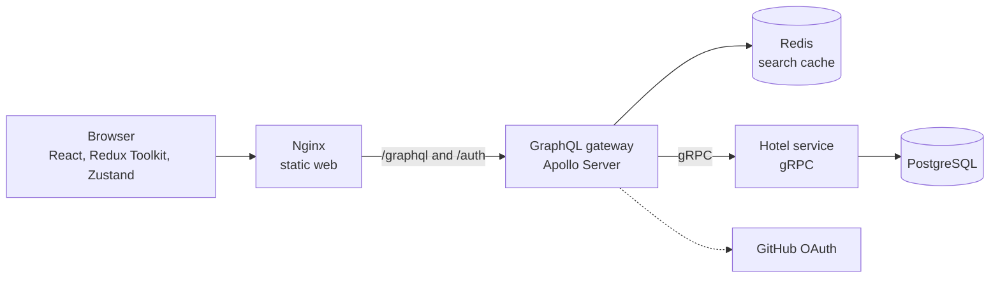
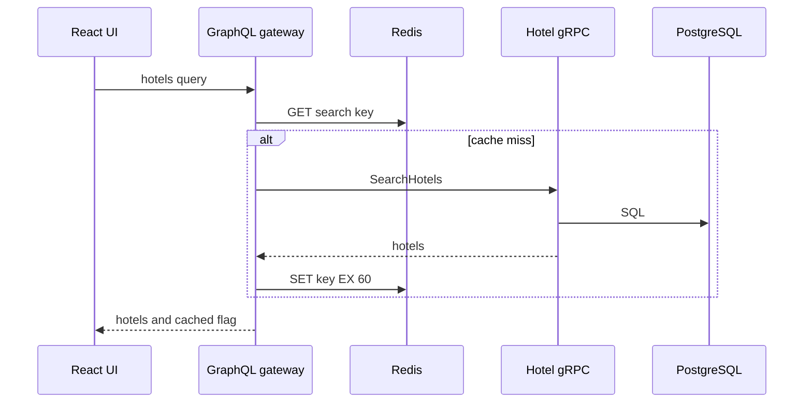
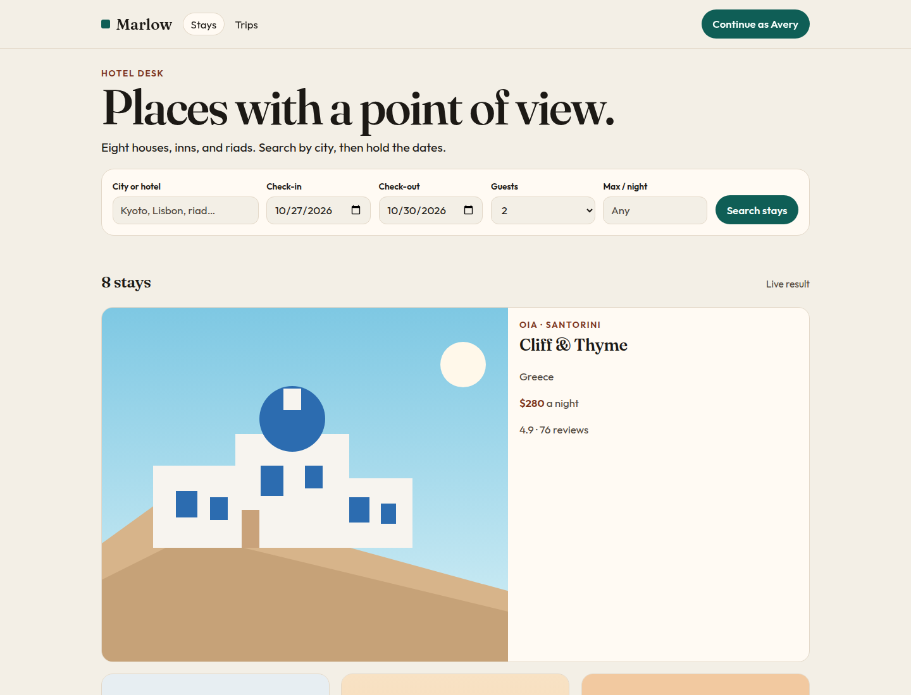
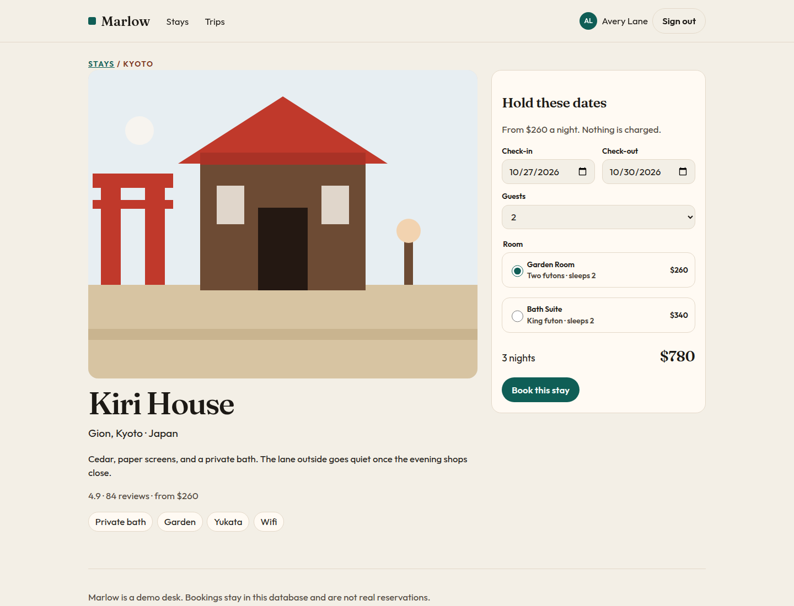
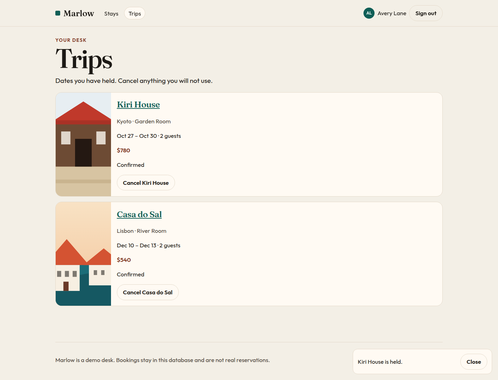

# Marlow

A small hotel desk: search eight stays, hold the dates, and cancel them later. Marlow is a portfolio demo of a React client, a GraphQL gateway, and a gRPC booking service.

Built by [Arpan Bom](https://github.com/applycoding).


## Architecture



Search results are cached in Redis for 60 seconds. A booking or cancellation clears that cache, because availability changed. The browser only talks to the web origin. Nginx serves the app and proxies GraphQL and auth to the gateway, so the session cookie stays same-site.



| Piece | Role |
| --- | --- |
| `apps/web` | Vite, React, TypeScript. Redux Toolkit holds search, session, and bookings. One Zustand store holds the mobile nav and toasts. |
| `apps/gateway` | Apollo Server on Express. GitHub OAuth via Passport, plus a mock sign-in so the demo runs without secrets. |
| `apps/hotels` | gRPC service. Owns Postgres, migrations, and the seed. |
| `proto/hotels.proto` | The contract between the gateway and the hotel service. |

## Screenshots







## Run it

Docker Compose is the one command. It builds the web app, the gateway, and the hotel service, and starts Postgres and Redis.

```bash
docker compose up --build
```

Open [http://localhost:8080](http://localhost:8080).

Choose **Continue as Avery** to sign in. That path is the mock OAuth stand-in: it upserts a demo traveler and sets an httpOnly session cookie. No GitHub client id is required.

Try a search for `Kyoto` or a max price of `200`. The result line says whether the list was cached. Book a room, then open Trips and cancel it. Booking the same room for overlapping dates returns an error from the hotel service.

Stop it with Ctrl-C, then `docker compose down`. The database volume is `marlow-pg`.

### GitHub OAuth

Mock sign-in is the default (`AUTH_MODE=mock`). To use GitHub as well:

1. Create an OAuth app with callback `http://localhost:8080/auth/github/callback`.
2. Start Compose with the credentials:

```bash
COMPOSE_AUTH_MODE=both \
GITHUB_CLIENT_ID=your-id \
GITHUB_CLIENT_SECRET=your-secret \
docker compose up --build
```

`COMPOSE_AUTH_MODE` can be `mock`, `github`, or `both`. GitHub mode refuses to boot until the client id, secret, and callback URL are set. Passport (`passport-github2`) performs the code exchange. The gateway stores only the profile id, name, email, and avatar.

Do not deploy the mock mode or the compose JWT secret (`dev-only-change-me`) anywhere public.

### Without the full Compose stack

For local development of the Node processes, Postgres and Redis still have to be running. Copy the sample env, then start the three dev servers.

```bash
cp .env.example .env
npm install
npm run dev
```

The Vite app is at [http://localhost:5173](http://localhost:5173) and proxies `/graphql` and `/auth` to the gateway on port 4000. Create the database to match `.env.example`:

```sql
CREATE USER marlow WITH PASSWORD 'marlow';
CREATE DATABASE marlow OWNER marlow;
```

You can also run only the data stores with `docker compose up postgres redis` and point `DATABASE_URL` at `localhost`.

## Tests

```bash
npm test
npm run typecheck
npm run build
```

Vitest covers stay pricing, the search SQL builder, session tokens, the GitHub profile mapping, cache keys, GraphQL search caching, and the Redux and Zustand stores. GitHub Actions runs those checks and `docker compose build` on every push to `main`.

## Layout

```
apps/web          React client
apps/gateway      Apollo GraphQL gateway
apps/hotels       gRPC service, migrations, seed
proto             hotels.proto
docker-compose.yml
```

Prices are whole US dollars. Stays are 1 to 30 nights, for 1 to 8 guests. The seed is idempotent and runs on hotel-service startup.
